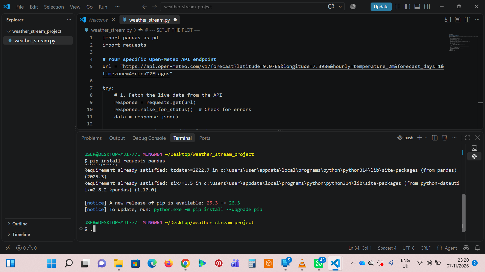

# Real-Time Weather Data Processing Pipeline

An automated, real-time data ingestion and processing pipeline that fetches live climate telemetry, structures it into relational data matrices, and provides dynamic data visualizations. 

## 👥 Group Information
* **Group Number:** Group 15
* **Project Focus:** Real-Time Data Processing

---

## 🚀 System Architecture & Workflow

The system is engineered using a decoupled three-stage data pipeline:
1. **Data Ingestion (REST API):** The system establishes an HTTP GET connection to the Open-Meteo REST API endpoint, pulling raw geographical and climate datasets seamlessly without requiring local data persistence.
2. **Data Parsing & Transformation (Pandas):** The incoming unstructured JSON payload is ingested by `pandas`. The system handles the nested vectors (`time` and `temperature_2m`), indexing them into a structured relational DataFrame matrix.
3. **Dynamic Visualization Loop (Matplotlib):** A streaming execution loop maps the structured timeline elements onto a live chart canvas, dynamically updating every few seconds to reflect moving trendlines.

---

## 🛠️ Tech Stack & Dependencies

* **Language:** Python 3.x
* **Network & Ingestion:** `requests` (v2.x+)
* **Data Processing & Matrices:** `pandas` (v2.x+)
* **Data Visualization Canvas:** `matplotlib` (v3.x+)

### Environment Initialization
To initialize the pipeline environment, open your terminal and install the core dependencies:
```bash
pip install requests pandas matplotlib
```

---

## 📸 Pipeline Verification & Screenshots

### 1. The Environment Setup (The Foundation)
* **What to capture:** Your terminal or command prompt showing the installation commands (`pip install requests pandas`).
* **Visual indicator:** A successful installation message with no red error text.




